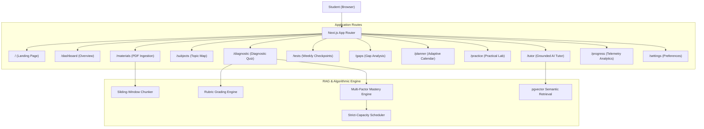

# GapFinder AI — Targeted Student Knowledge Gap Learning System

[](https://nextjs.org/)
[](https://www.typescriptlang.org/)
[](https://tailwindcss.com/)
[](https://supabase.com/)
[](https://aistudio.google.com/)
[](https://vitest.dev/)

GapFinder AI helps students identify what they **do not understand**, instead of repeatedly revising topics they already know.

Students upload their syllabus and learning materials, create a personalized learning schedule, report difficult concepts, take diagnostic and weekly tests, receive evidence-grounded feedback with authentic citations, practice problem-solving, and observe measurable improvement over time.

---

## 🌟 Key Capabilities

1. **Syllabus & Material RAG Pipeline**:
   - Ingestion of `.pdf`, `.txt`, and `.md` course notes.
   - Text sanitization against untrusted prompt injections.
   - Overlapping semantic chunker preserving chapter/section titles and page numbers.
   - 768-dimensional vector embedding storage via `pgvector`.
2. **Automatic Topic Knowledge Map**:
   - Subject → Unit → Topic → Subtopic hierarchical tree.
   - Provenance tracking (distinguishing syllabus-derived topics from notes-derived topics).
   - Independent self-reported confidence (1–5 stars) vs. verified test evidence (0–100%).
3. **Diagnostic Assessments & Rubric Evaluation**:
   - MCQ, numerical, and free-text question formats.
   - Objective grading against answer keys and rubric-grounded multi-criterion evaluation.
   - Post-test feedback: correct criteria, missing elements, why expected answer is better, and linked source citations.
4. **Multi-Factor Gap Analysis**:
   - Classifies topics into **Weak** (<50%), **Medium** (50–79%), **Strong** (80%+), and **Insufficient Evidence** (<2 attempts).
   - Weighted assessment performance factoring in difficulty levels and recency decay.
   - Tracks repeated error patterns.
5. **Time-Capped Adaptive Study Planner**:
   - Daily and weekly calendar scheduling.
   - **Hard Constraint**: Never schedules more study time than the student has available (e.g. 2.5h/day limit).
   - Workload conflict alerts when weak topic demand exceeds student study capacity.
   - Clear *"Why Recommended"* rationale for every scheduled task.
6. **Explain-This-Topic AI Tutor**:
   - Scope-restricted conversational tutor grounded strictly in uploaded documents.
   - Clickable source citations showing exact document, page number, and highlighted excerpt.
   - Refusal mechanism (`isUnsupported: true`) if grounding evidence is insufficient.
7. **Practical Application Lab**:
   - Numerical problems, worked step-by-step simulations, challenge tasks, and mistake reflection.
8. **Progress Analytics & Reporting**:
   - Empirical telemetry charts via Recharts (Accuracy trend over time, weekly benchmark comparisons).
   - 1-click CSV export of student performance.
9. **Zero-Setup Demo Mode**:
   - Pre-seeded with a comprehensive curriculum: **CS301 Distributed Systems & Database Architecture**.
   - Fully interactive even without external Supabase or Gemini API keys!

---

## 🏗️ Architecture



---

## 🚀 Quick Start

### 1. Prerequisites
- Node.js `v18+` or `v20+` (Tested on `v24`)
- npm or pnpm

### 2. Installation
```bash
git clone https://github.com/your-username/gapfinder-ai.git
cd gapfinder-ai
npm install
```

### 3. Environment Configuration (Optional)
The application works immediately in **First-Class Demo Mode** without configuration. To enable live Google Gemini AI and Supabase PostgreSQL:

```bash
cp .env.example .env.local
```

Edit `.env.local`:
```env
# Google Gemini (for live generative question & tutor responses)
GEMINI_API_KEY=your_gemini_api_key

# Supabase (for persistent remote cloud PostgreSQL & pgvector)
NEXT_PUBLIC_SUPABASE_URL=https://your-project.supabase.co
NEXT_PUBLIC_SUPABASE_ANON_KEY=your-supabase-anon-key
SUPABASE_SERVICE_ROLE_KEY=your-supabase-service-role-key
```

### 4. Run the Development Server
```bash
npm run dev
```
Open [http://localhost:3000](http://localhost:3000) in your browser.

### 5. Run the Test Suite
```bash
npm test
```
Runs 9 comprehensive unit tests verifying mastery formulas, strict capacity scheduler, rubric grading, and RAG student data isolation.

### 6. Build for Production
```bash
npm run build
npm start
```

---

## 🧪 Testing Verification Checklist

| Test Suite | Purpose | Status |
| :--- | :--- | :--- |
| `tests/mastery.test.ts` | Multi-factor mastery formula, recency decay, <2 sample-size threshold | **PASSED** |
| `tests/scheduler.test.ts` | Strict daily study hour limit, priority sorting of weak topics | **PASSED** |
| `tests/grading.test.ts` | Objective MCQ grading, numerical precision, rubric criteria | **PASSED** |
| `tests/rag.test.ts` | Overlapping semantic chunking, student data isolation, citation validation | **PASSED** |

---

## ⚖️ Limitations & Future Enhancements

- **Current Limitations**:
  - OCR for handwritten notes is not currently implemented; scanned documents should be converted to readable text or PDF before ingestion.
  - In demo mode, state is persisted in browser localStorage rather than a cloud multi-device sync until Supabase credentials are provided.
- **Future Roadmap**:
  - Multi-student study group cohorts and comparative mastery percentiles.
  - Integration with Canvas LMS and Google Classroom APIs for automatic assignment synchronization.
  - Voice-driven conversational tutor using Gemini Live Multimodal API.

---

## 📄 License
MIT © GapFinder AI Team. Built for high-impact educational assessment.
