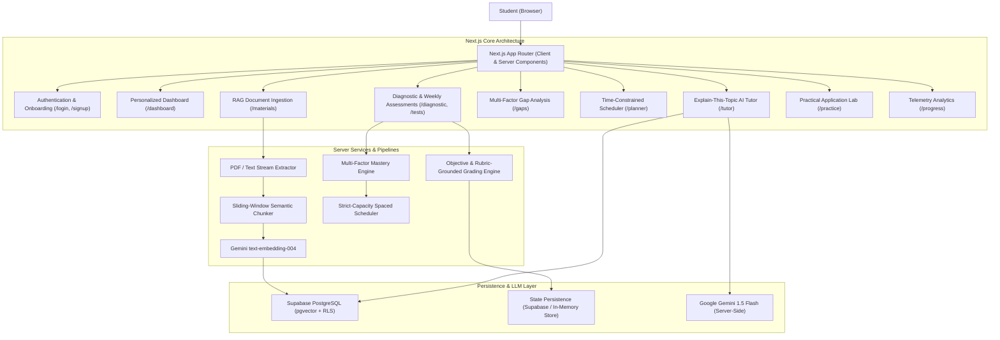

# GapFinder AI — System Architecture

## Overview
GapFinder AI is a production-oriented web application designed to help students discover and resolve foundational concept gaps in their academic curriculum. Rather than repeatedly reviewing familiar material, GapFinder AI uses evidence-grounded assessment, RAG document ingestion, time-constrained scheduling, and material-grounded tutoring.

## Route Topology

| Route | Role |
| :--- | :--- |
| `/` | Public marketing landing page with comparison matrix |
| `/login` | Authentication page with 1-click evaluator demo sign-in |
| `/signup` | 3-step student onboarding wizard collecting capacity & exam targets |
| `/dashboard` | Personalized learning overview, alerts, and today's schedule |
| `/materials` | Upload, sanitize, extract, chunk, and index syllabus PDFs |
| `/subjects` | Hierarchical topic tree with source provenance & confidence scores |
| `/diagnostic` | Diagnostic test runner with rubric evaluation & citations |
| `/tests` | Weekly adaptive checkpoint tests and score history |
| `/gaps` | Topic-level gap classification with sample size thresholds |
| `/planner` | Daily & weekly calendar with strict study hour limits |
| `/practice` | Scenario-based problem solving with step-by-step simulations |
| `/tutor` | RAG conversational assistant with authentic page citations |
| `/progress` | Recharts empirical telemetry, score trends, and CSV export |
| `/settings` | Notification permissions, exam date targets, and demo reset |

## Technology Stack

- **Framework**: Next.js 14.2 (App Router)
- **Language**: TypeScript in Strict Mode
- **Styling**: Tailwind CSS with shadcn/ui design language
- **Vector Storage**: Supabase PostgreSQL with `pgvector`
- **Embedding Model**: Google Gemini `text-embedding-004` (768 dimensions)
- **LLM Engine**: Google Gemini `gemini-1.5-flash`
- **Visual Analytics**: Recharts
- **Validation**: Zod schema validation
- **Testing**: Vitest test runner
