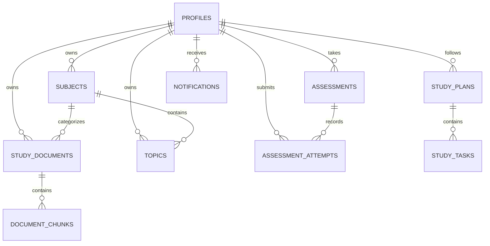

# GapFinder AI — Database Schema & Data Models

## Overview
GapFinder AI uses a normalized relational schema on Supabase PostgreSQL with the `vector` extension (`pgvector`). All private records are protected by Supabase Row Level Security (RLS) policies.

## Entity Relationship Diagram



## Primary Tables

### 1. `profiles`
- `id` (UUID, PK, references `auth.users`)
- `email` (TEXT)
- `name` (TEXT)
- `education_level` (TEXT)
- `exam_goals` (TEXT[])
- `target_exam_date` (DATE)
- `available_days` (TEXT[])
- `daily_study_hours` (NUMERIC)
- `session_duration_minutes` (INT)
- `reminder_times` (TEXT[])
- `onboarding_completed` (BOOLEAN)

### 2. `study_documents`
- `id` (UUID, PK)
- `user_id` (UUID, FK -> `profiles.id`)
- `subject_id` (UUID, FK -> `subjects.id`)
- `filename` (TEXT)
- `original_name` (TEXT)
- `file_size_bytes` (BIGINT)
- `processing_status` (TEXT: `pending`, `extracting`, `chunking`, `embedding`, `indexed`, `failed`)
- `total_chunks` (INT)
- `total_characters` (INT)

### 3. `document_chunks`
- `id` (UUID, PK)
- `document_id` (UUID, FK -> `study_documents.id`)
- `subject_id` (UUID, FK -> `subjects.id`)
- `user_id` (UUID, FK -> `profiles.id`)
- `chunk_index` (INT)
- `content` (TEXT)
- `page_number` (INT)
- `section_title` (TEXT)
- `embedding` (VECTOR(768))

### 4. `topics`
- `id` (UUID, PK)
- `subject_id` (UUID, FK -> `subjects.id`)
- `chapter_title` (TEXT)
- `title` (TEXT)
- `confidence` (INT: 1-5)
- `mastery_score` (NUMERIC: 0-100)
- `mastery_level` (TEXT: `weak`, `medium`, `strong`, `insufficient_evidence`)
- `mastery_reason` (TEXT)
- `provenance` (TEXT: `syllabus`, `notes`, `manual`)
- `repeated_error_patterns` (TEXT[])

### 5. `assessment_attempts`
- `id` (UUID, PK)
- `user_id` (UUID, FK -> `profiles.id`)
- `subject_id` (UUID, FK -> `subjects.id`)
- `assessment_type` (TEXT: `diagnostic`, `weekly_test`)
- `percentage_score` (NUMERIC)
- `earned_marks` (NUMERIC)
- `total_marks` (INT)
- `responses` (JSONB)
- `identified_gaps` (JSONB)

### 6. `study_tasks`
- `id` (UUID, PK)
- `plan_id` (UUID, FK -> `study_plans.id`)
- `user_id` (UUID, FK -> `profiles.id`)
- `topic_id` (UUID, FK -> `topics.id`)
- `title` (TEXT)
- `duration_minutes` (INT)
- `priority` (TEXT: `high`, `medium`, `low`)
- `scheduled_date` (DATE)
- `status` (TEXT: `scheduled`, `completed`, `skipped`)
- `reason_why_recommended` (TEXT)

## pgvector Similarity Stored Function
```sql
CREATE OR REPLACE FUNCTION match_document_chunks (
  query_embedding VECTOR(768),
  match_threshold FLOAT,
  match_count INT,
  filter_user_id UUID,
  filter_subject_id UUID DEFAULT NULL
)
RETURNS TABLE (
  id UUID,
  document_id UUID,
  chunk_index INT,
  content TEXT,
  page_number INT,
  section_title TEXT,
  similarity FLOAT
)
LANGUAGE plpgsql
AS $$
BEGIN
  RETURN QUERY
  SELECT
    dc.id,
    dc.document_id,
    dc.chunk_index,
    dc.content,
    dc.page_number,
    dc.section_title,
    1 - (dc.embedding <=> query_embedding) AS similarity
  FROM public.document_chunks dc
  WHERE dc.user_id = filter_user_id
    AND (filter_subject_id IS NULL OR dc.subject_id = filter_subject_id)
    AND 1 - (dc.embedding <=> query_embedding) >= match_threshold
  ORDER BY dc.embedding <=> query_embedding
  LIMIT match_count;
END;
$$;
```
