# GapFinder AI — Retrieval-Augmented Generation (RAG) Pipeline

## 1. Overview
The GapFinder AI RAG pipeline ensures that every diagnostic assessment, weekly test, explanation, and tutor response is grounded directly in the student's uploaded syllabus and study materials. It prevents hallucinations, validates source citations, and protects against adversarial prompt injections embedded in uploaded documents.

```mermaid
flowchart LR
    A["Raw Document (.pdf / .txt)"] --> B["Sanitization & Extraction"]
    B --> C["Semantic Chunker (Sliding Overlap)"]
    C --> D["Embedding Generator (Gemini 768d)"]
    D --> E["pgvector Storage (Isolated by User)"]
    E --> F["Vector Similarity & Hybrid Search"]
    F --> G["Citation Validation Engine"]
    G --> H["Grounded Generation & Rubric Grading"]
```

## 2. Ingestion Pipeline
1. **Document Upload & Sanitization**:
   - Accepts `.pdf`, `.txt`, and `.md` files up to 25 MB.
   - Text is sanitized via `sanitizeDocumentText()` to neutralize potential prompt injections (e.g. `"Ignore previous instructions..."`).
2. **Text Extraction**:
   - `pdf-parse` extracts raw text and tracks approximate page breaks (~2,500 characters per standard PDF page).
   - If a PDF uses compressed or non-standard font streams, an automated fallback extracts visible text streams.
3. **Sliding-Window Semantic Chunking**:
   - Configurable chunk size (600–800 characters) with 120–150 character overlap.
   - Preserves section and chapter headers (e.g. `Section 2.4: Two-Phase Locking`) and assigns page numbers.
4. **Vector Embedding**:
   - Embeddings are computed with Google Gemini `text-embedding-004` (768 dimensions).
   - Chunks are stored in the `document_chunks` table in Supabase PostgreSQL with an `ivfflat` cosine index.

## 3. Retrieval Pipeline
- **Student Data Isolation**: Retrieval queries strictly filter on `userId = authenticated_user_id` and optionally `subjectId`.
- **Cosine Similarity & Hybrid Search**:
  - Distance formula: `1 - (dc.embedding <=> query_embedding)`.
  - Configurable relevance threshold (default: 0.45).
- **Adequacy Check**: If retrieved chunks fall below the threshold or no passages match, the pipeline explicitly returns an `isUnsupported: true` flag and warns the student that available material is insufficient.

## 4. Citation Validation & Anti-Hallucination
- Every cited passage must match a real chunk stored in the database.
- Fabricated document IDs or page numbers from LLM completions are filtered out before reaching the client interface.
- Clicking any citation in the UI opens the **Verified Source Citation Modal**, presenting the exact document name, page number, section header, and highlighted excerpt.
